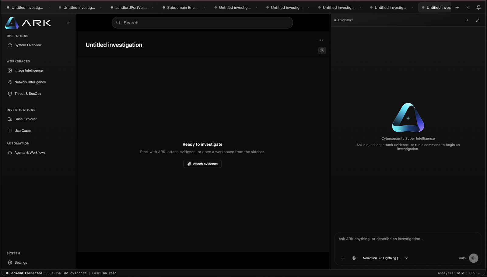
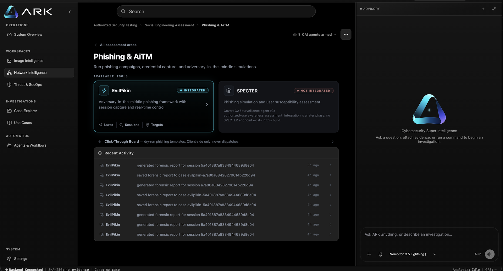
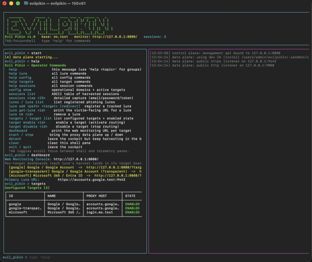

<div align="center">

# ARK — Cybersecurity Super Intelligence

**An AI-native security investigation workstation by Arkspan Systems.**

Deterministic forensics, cryptographic evidence integrity, and governed agentic
reasoning in a single operational control plane.

[](https://python.org)
[](https://fastapi.tiangolo.com)
[](https://react.dev)
[](https://electronjs.org)
[](#licensing)

[Overview](#overview) · [Screenshots](#screenshots) · [Capabilities](#capabilities) · [EVILPIKIN](#evilpikin-integration) · [Architecture](#architecture) · [Downloads](#downloads) · [BYOK](#bring-your-own-keys) · [Roadmap](#roadmap)

</div>

---

> **Release status — developer preview.** A **v0.1.0-demo** build for macOS is published on the
> [Releases](../../releases) page as an **unsigned developer preview for demo showcase and
> evaluation**. It is not a production release: macOS will refuse to open it without the
> workaround documented in [Downloads](#downloads), there is no auto-updater, and some
> capabilities are intentionally unfinished or dry-run only (called out below).
> Windows and Linux packages are not published yet.

---

## Screenshots

> Current desktop builds — the v0.1.0-demo surfaces as they ship.

| Start an investigation | Tabs-first workbench |
|---|---|
|  |  |

| Authorized Security Testing | Phishing & AiTM — EVILPIKIN |
|---|---|
|  |  |

---

## Overview

ARK unifies deterministic forensic analysis, evidence management, security operations,
agentic reasoning, and controlled tool execution into one workstation. It is built around a
single principle:

> **The human operator decides what to investigate. ARK determines what can be trusted,
> what can be safely executed, and how the investigation is recorded with cryptographic
> integrity.**

Originating as an image-forensics and visual-intelligence platform, ARK has grown into a
multi-domain security operations control plane while keeping its deterministic forensic
foundations. It integrates a customized fork of the
[CAI (Cybersecurity AI) Robotics Framework](https://github.com/0x4rn0s/CAI) as its agent
substrate.

**Delivered as:** a FastAPI backend, a React workbench, an Electron desktop app, and an
React Native mobile companion (source only, no published package yet).

**The desktop app works fully offline** — no ARK servers, no sign-up, no telemetry out of the
box. Models come from your own providers (BYOK) or a local Ollama install; deterministic
forensic tooling needs no keys at all.

---

## Capabilities

### Investigation domains

| Domain | Focus | Status |
|---|---|---|
| **Image Intelligence (IMINT)** | EXIF/XMP/MakerNote analysis via ExifTool, Error Level Analysis (ELA), OCR, visual clue extraction, geolocation fusion, C2PA provenance, consistency & contradiction analysis | Active |
| **Network Intelligence** | RDAP / BGP / DNS / certificate-transparency discovery, crt.sh subdomain enumeration, and the **Authorized Security Testing** module suite (see below) | Active |
| **Threat & SecOps** | Network Intelligence layout, SIEM/Alerts workspaces (in development) | In development |
| **OSINT** | Open-source discovery, reverse visual search, domain and perceptual-hash matching | Active |
| **Cases & Vault** | Immutable evidence storage, chain-of-custody logging, audit bundles, cross-domain case management | Active |
| **System Overview** | Principal-scoped operations KPIs, provider health, usage, custody and execution traces | Active |
| **Agents & Workflows** | Background plan/execute/check orchestration against declared engagements | Active |

### Authorized Security Testing (Network Intelligence → Testing)

Every active-testing module sits behind a signed **security attestation** and an admin-declared
**engagement**; without one, target-bearing probes fail closed. Ask ARK (the in-workspace
guidance assistant) is only offered after a module has produced real results.

| Module | What it does today | Status |
|---|---|---|
| **Vulnerability Assessment** | 4-step wizard (Target → Profile → Run → Results) driving seven tracks — Nuclei, OpenVAS, Nmap NSE, OWASP Dependency-Check, Proton-Fuzz, Shadow-Route, Aegis-Patch. Deterministic dry-run engine locally; real engines execute when wired to a backend that has them | Demo (dry-run) |
| **Exposure & Secret Testing** | **Real engine, no simulation**: engagement-gated public-exposure audit (DNS recon with SPF/DMARC/CAA analysis, TLS certificate inspection, HTTP security-header audit, sensitive-path probes — `.env`, `.git/config`, credentials files) plus **offline secret detection** (16-pattern registry with Shannon-entropy gating, e.g. AWS/GCP/GitHub/Slack/Stripe/PEM/JWT/DB-connection strings) and a **GitHub public org/user scan** via the unauthenticated API rate limits honestly reported. Findings fold into the case, export CSV/JSON, and drive generated REMEDIATION guidance — never canned output | Active |
| **Web / API Security** | DAST profile, OpenAPI surface parser, endpoint crawler (config-time module) | Demo |
| **Compliance / Baseline** | CIS benchmark audit with Ansible remediation generation (pinned baselines embedded) | Demo |
| **RE-ACT Chain** | Plan → Scan → Exploit → Escalate → Mitigate chain executor | Demo |
| **Social Engineering Assessment** | Authorized human-layer assessment surface — see [EVILPIKIN integration](#evilpikin-integration) | In development |
| **Phishing & AiTM** | EVILPIKIN-backed lure/session/target management with live status, session capture review, cookie-drift analysis and forensic reporting, folded into case evidence | Active (operator-run) |

### Investigation workflows

- **Direct Evidence Mode (deterministic).** Upload an artifact and get a reproducible,
  auditable forensic report: SHA-256 hashing, metadata extraction, forensic analysis,
  OCR and geolocation, then a court-ready case file.
- **AI Investigation Mode (goal-driven).** Describe an objective; ARK proposes a plan, the
  analyst approves or modifies it, and ARK executes it through the tool registry — adapting
  the plan as new evidence appears. An admin-declared **engagement** scopes every
  target-bearing action; manual-control mode pauses for per-action approval.
- **Tabs-first workbench.** Investigation tabs persist across restarts with their case,
  conversation and evidence binding; reopening a session restores the workspace exactly
  where it was left.
- **Terminal Agent.** A live streaming console for natural-language interaction with
  slash commands (`/agent`, `/ws`, `/tools`, `/help`) and human-in-the-loop approvals
  (Allow once / Allow always / Deny).

### Forensic pipeline

Every investigation flows through a deterministic core: metadata extraction, a vision
ensemble, six clue extractors, and a consensus engine — followed by consistency,
contradiction, and geolocation-fusion passes that produce unified observations and a
court-ready report.

---

## EVILPIKIN integration

[EVILPIKIN](https://github.com/UncleT-cyber/evilpikin) is an operator-controlled **Adversary-in-The-Middle (AiTM) phishing proxy** with a data plane and a control API — a tool class used by threat teams and red programs for **authorized** phishing-attack simulation, not a spoofing kit for public use. ARK integrates with a running EVILPIKIN instance as one closed-loop capability inside the Social Engineering Assessment workspace.

<p align="center">
  
</p>
<p align="center"><em>The EVILPIKIN operator cockpit: command surface on the left, data-plane telemetry on the right, configured target roster at the bottom. Shown against lab <code>.test</code> domains; ARK operators drive the same instance from inside the workbench.</em></p>

### What it does inside ARK

- **Closed-loop operation.** ARK plans the assessment (lure selection, target assignment, cookie analysis) → the **operator declares the engagement** → EVILPIKIN executes the AiTM flow against the declared target → captured data flows back → ARK analyzes and records it as case evidence. ARK never fires an AiTM flow on its own initiative, and nothing leaves the declared scope.
- **Target & lure management.** Full target profiles (routing matrix, cookie-tracking list, login URLs), lure registration and activation, DNS write-backs to EVILPIKIN through operator-approved, fingerprinted grants — the operator approves once or always, per exact operation; approvals cannot be smuggled onto a modified request.
- **Session capture review.** The Sessions table renders captured rows (target, username/password/OTP, flow, cookies, status) — values are masked at capture time. Each row can export a markdown evidence sheet (custody pointer included), export raw cookies JSON, or fold into the case as custody-hashed evidence.
- **Cookie-drift analysis.** ARK diffs the target's tracked cookie set against its live login surface (`captures` ∪ `probe`), surfaces untracked cookies with provenance, and prepares a **deterministic drift proposal** — names only, never values — for operator review before any profile write-back. ARK's read-only agents can *see* the data plane (recon snapshot, cookie map, drift proposals); **writes stay operator-only** behind per-operation approval.
- **Forensic reporting.** After a session completes, ARK generates an attack report and a court-ready forensic report, saved durably into the ARK case store (`arkgeo_case_reports`) with its custody hash — the same chain-of-custody as every other artifact.

### Assessment and mitigation — the part that makes ARK the brain

Harvesting a session is evilpikin's job. **Understanding it is ARK's.** Three layers run over a captured session, in order:

1. **Deterministic assessment — no model required.** ARK reconstructs the attack path as an auditable timeline (`LURE CLICK → TARGET ACTIVE → UPSTREAM PROXIED → CAPTURED`), records the delivery chain, proxy and upstream hosts, and captured cookie **names** (never values), and proposes mitigations with rule-based logic driven by what the capture actually showed — e.g. hardware-bound FIDO2/WebAuthn when credentials leaked (password+OTP are relayable through an AiTM proxy; FIDO2 is not), session-token binding and shorter TTLs for captured cookies, conditional access, DNS resolver-intercept monitoring, and Certificate Transparency alerts for the phishing domain. Severity and rationale are attached to every proposal; you tick which ones fold into the case.
2. **AI root-cause assessment — model credential required, HITL-gated.** A non-sensitive digest (attack path, hosts, drift findings, mitigation proposals — never secret values) is projected into a three-specialist chain: **Blue Team** (severity, false-positive likelihood, blast radius), **DFIR** (timeline and IOCs), **Reporting** (root-cause brief). Containment proposals become *approval requests*, never executions. Without a model key this layer degrades honestly to `skipped_no_ai` and the deterministic layer still stands on its own.
3. **Structural promotion rule.** Attack-path hypotheses enter the case evidence graph at tier 2, and a tier-2 node cannot be promoted to a finding without corroboration from a higher epistemic tier — enforced by the evidence graph itself, not by prompt wording. The AiTM narrative must agree with the rest of the case (or be blocked) before it is treated as established fact.

Everything lands in the case: the attack report, the triage artifact, the drift findings, the selected mitigations, each custody-hashed. The AI proposes; the operator disposes.

Honest gaps today: mitigations are static rules, not organization-aware (no notion of "policy X already covers this"); root-cause quality depends entirely on the model you configure; there is no re-probe to confirm a mitigation actually closed the hole; and both halves are only as good as the session quality evilpikin captured.

### What is deliberately not real yet

- **SPECTER** (an agentic C2/surveillance sibling) is listed in the workspace with a truthful **Not integrated** chip — there is no ARK endpoint for it today and none is implied.
- **Vishing / Smishing** show "not available" states; no live calling or SMS pipeline exists in ARK. **Pretexting** provides a pretext builder and OSINT recon assist only. **Physical Access** provides device-drop planning UI, not execution. **Awareness & Training** tracks susceptibility metrics — managed campaigns live outside ARK (planned).
- The **Click-Through Board** is a dry-run board for scoring simulated clicks; no live mailer is dispatched.
- **Caught anything? It goes into the case, nowhere else.** Captured artifacts stay on the operator's machine under the declared engagement; they are never uploaded to any Arkspan service.

### Required setup

EVILPIKIN runs as its own service (control API + data plane). ARK discovers it via
the workspace **Phishing & AiTM** panel (Connection status chip: Integrating / Connected),
configures auth via `GET/POST /api/v1/network/evilpikin/config` (token or mTLS), and shows
live per-tab status for Targets / Lures / Sessions / Telemetry / Monitor. Read the
EVILPIKIN documentation in its own repository before provisioning a VPS for it.

> **Responsible use.** EVILPIKIN and the Social Engineering workspace are for explicitly
> authorized red-team and threat-assessment engagements only — your own organization or a
> client with a signed ROE. ARK's engagement scope, attestation and audit trail exist so
> that nothing runs outside that authorization. Misuse is out of scope for support.

---

## Architecture

ARK separates responsibilities across three entities to keep epistemic rigor and
operational safety:

| Entity | Role | Outputs |
|---|---|---|
| **Operator (human)** | Intent, judgment, authorization, final assessment | Objectives, approvals, case disposition |
| **ARK Core** | Deterministic analysis, evidence preservation, hashing, tool runtime | Verified facts, sensor readings, raw logs |
| **ARK — Cybersecurity Super Intelligence** | The user-facing AI: planning, tool orchestration, multi-step reasoning, cross-domain correlation (runs on CAI) | Investigation plans, hypotheses, execution graph |

**Facts and hypotheses are kept structurally separate.** ARK Core produces facts; the AI
produces hypotheses. A hypothesis cannot be promoted to a finding without corroboration
from a higher epistemic tier, and this is enforced in the evidence graph — so a
contradiction always resolves in favor of the higher tier.

Core components:

| Component | Purpose |
|---|---|
| **Tool Registry** | Every capability the AI can call is registered with schema, permissions, risk level, cost estimate, and audit requirements. |
| **Evidence Graph** | Tamper-evident, hash-validated nodes and edges (corroborate / contradict / derived-from). The spine of the system. |
| **Policy Guard** | Authorization surface between planner and execution: capability permissions, risk-based approval tiers, budgets, and availability gating. |
| **Engagement Scope** | The execution boundary: admin-declared engagements pin targets and windows; target-bearing calls outside the declaration fail closed before dispatch (Loopback honesty, manual mode, fingerprinted one-shot grants). |
| **Model Gateway** | Provider-agnostic LLM access with local (Ollama) and cloud providers; your saved preference wins over the admin default. |
| **Security Event Store** | Durable, principal-scoped, versioned security events (deduped, audited) — feeds notifications and case evidence. |

---

## Technology

| Layer | Technology |
|---|---|
| Backend | Python 3.12+, FastAPI 0.162, Pillow 13, piexif, pydantic 2, cryptography |
| AI / LLM | Ollama (local), OpenAI, Anthropic, Gemini, OpenRouter, HuggingFace — litellm routing, optional bounded retry |
| Frontend | React 18, TypeScript 5, Vite 5, Leaflet |
| Desktop | Electron 32 (macOS / Windows / Linux) |
| Mobile | React Native 0.74, Expo 51 (source only) |
| Forensics | ExifTool, OCR (tesseract), C2PA / Content Credentials |
| Security | AES-256-GCM field encryption, JWT + bcrypt authentication, SHA-256 chain-of-custody, per-install generated local secrets (never shipped in the app) |
| Detection | dnspython, entropy + pattern secret engine (offline) |

---

## Downloads

> **v0.1.0-demo — developer preview, unsigned macOS build.** For evaluation and demo showcase.
> Not approved for production use, and not intended for active engagements against third-party systems.

| Platform | Artifact | Size | SHA-256 |
|---|---|---|---|
| macOS (x86_64; Apple Silicon via Rosetta 2) | [THE ARK-0.1.0.dmg](../../releases/download/v0.1.0-demo/THE.ARK-0.1.0.dmg) | 274 MB | `064c3e436503209b789d02ee6a96862eaf8f2f04c78da55281534992040992b2` |
| macOS (x86_64) | [THE ARK-0.1.0-mac.zip](../../releases/download/v0.1.0-demo/THE.ARK-0.1.0-mac.zip) | 280 MB | `8a80ca1aa9e13d39b8d8debc04437d45479a43f3a951209dcd12ecd5d6fb23be` |
| Windows / Linux | Not published yet — requires per-OS backend runtimes | — | — |

### Verify (macOS)

```bash
shasum -a 256 ~/Downloads/THE\ ARK-0.1.0.dmg
# expect: 064c3e436503209b789d02ee6a96862eaf8f2f04c78da55281534992040992b2

# The build is unsigned. macOS quarantines apps downloaded from the internet,
# so Gatekeeper will block it — this is expected, not corruption:
xattr -dr com.apple.quarantine "/Applications/THE ARK.app"
open "/Applications/THE ARK.app"
```

On Apple Silicon the x64 build runs under Rosetta 2 — install Rosetta when prompted
(`softwareupdate --install-rosetta`). x86_64 native hosts run it directly.

### First run

1. Install the app, open it, and you will land on a blank canvas — there is no sign-up.
2. **Connect a model** — Settings → Providers & Connections: either point ARK at a local
   Ollama (`qwen2.5-coder` class models work locally) or add your own provider keys
   (OpenAI / Anthropic / Gemini / OpenRouter / HuggingFace). Without keys, deterministic
   forensic tooling works but the AI investigation layer does not.
3. **Declare an engagement** before any network probe — Admin → Engagement & Scope
   (or an environment fixture for lab use). Authorized Security Testing refuses before
   dispatch without one; this is a feature, not a limitation.
4. Image files dropped into **Image Intelligence** give you the full deterministic pipeline
   immediately.

Known gaps in this preview:

- No code signing or notarization (macOS will warn; workaround above). Upgrade path is tracked.
- No auto-updater — reinstall over or beside the old app.
- Only the macOS x64 build exists; Windows/Linux wait on CI machines.
- The desktop app embeds the backend on a loopback port and keeps all state on your machine.
- Mobile companion and the Admin multi-user plane are not in this build.

See [docs/RELEASE_CHECKLIST.md](docs/RELEASE_CHECKLIST.md) for the release gates and
[docs/RELEASE_NOTES_TEMPLATE.md](docs/RELEASE_NOTES_TEMPLATE.md) for the notes structure.
Follow the [Releases](../../releases) page for updates.

---

## Bring your own keys

ARK is designed to run with your own AI provider credentials (BYOK) and can operate with a
local model. Provider keys are stored locally, AES-256-GCM encrypted, never sent to Arkspan,
and never leave your machine except to the provider you configure. Supported providers,
credential-storage behavior and per-release notes are documented with each validated release.

---

## Roadmap

| Phase | Scope | Status |
|---|---|---|
| A | Tool registry and tamper-evident evidence graph | Done |
| B | Policy / permission guard and audit emission | Done |
| C | Orchestrator loop: planner and executor for one goal | Done |
| D | Investigation console: plan / agent / evidence views | Done |
| E | Adaptive re-planning, contradiction loops, cost budgets | Done |
| F | Cross-domain reuse: register network and SecOps tools | Done |
| G | Case engine unification and cross-domain evidence graph | Done |
| H | Model routing, provider failover, cost optimization | Done |
| I | Court-ready evidence bundles and export formats | Planned |
| J | Analyst productivity, batch operations, collaborative cases | Planned |
| K | Signed + notarized macOS release; Windows/Linux CI builds; auto-update | Planned |

---

## Safety and responsible use

ARK is intended for authorized cybersecurity investigation, research and defensive
operations. Operate only on systems and accounts you own or are expressly permitted to
assess. The EVILPIKIN integration and every target-bearing tool are gated by engagement
scope, operator attestation and per-operation approval; they are not license to attack
systems that are not yours. Tool availability and third-party provider terms may vary.

---

## Reporting issues and vulnerabilities

For ordinary bugs and feature requests, use **[Issues](../../issues)**. Do **not** post
credentials, sensitive logs, private investigation data, exploit details, or security
vulnerabilities in public issues. See [SECURITY.md](SECURITY.md) for responsible reporting
guidance.

---

## Licensing

THE ARK is released under the **MIT License**. It integrates the
[CAI (Cybersecurity AI) Robotics Framework](https://github.com/0x4rn0s/CAI), which retains
its own dual licensing: MIT for its OpenAI-derived components, and a research-use license
for proprietary Alias Robotics components. CAI is **not** relicensed under the MIT license
of THE ARK; commercial use of research-use components requires a separate license from
[Alias Robotics](https://aliasrobotics.com). The packaged app bundles CAI's license files
(MIT + research-use) alongside the application.

This repository hosts release information and distribution materials. See
[CONTRIBUTING.md](CONTRIBUTING.md) for how to report problems.

---

<div align="center">

**ARK — Investigate. Correlate. Preserve.**

*A security investigation environment where AI can reason and act without becoming the
authority over the evidence.*

Developed by **Arkspan Systems**.

</div>
