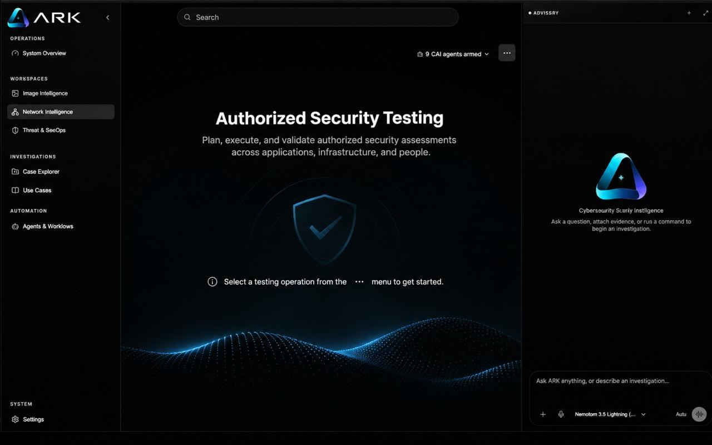

# ARK — Cybersecurity Super Intelligence

**ARK** is a cybersecurity investigation workstation developed by **Arkspan Systems**.

ARK is planned for free desktop distribution. Bring your own supported AI provider keys (BYOK); future optional model services will not be required for using the core framework.

> **Release status:** No public installer has been published yet. This repository is a distribution and support channel, **not** ARK's development source repository.

## Screenshots

> Screenshots are from an in-development build and are provided for demonstration only. No public installer is available yet.

| | |
|---|---|
|  |  |
| **Start an investigation** — describe an investigation or attach evidence to begin. | **Workspaces and cases** — Image, Network and Threat & SecOps workspaces with the Case Explorer. |
|  |  |
| **Authorized security testing** — plan and validate authorized assessments. | **Phishing & AiTM** — run authorized phishing and adversary-in-the-middle simulations. |

See [Adding screenshots](#adding-screenshots) to replace or add images.

## Highlights

- **Investigation workstation** — a desktop environment built around cybersecurity investigation workflows.
- **Bring your own keys (BYOK)** — configure supported AI providers with your own credentials; no vendor account required to use the core framework.
- **Free desktop distribution** — the core framework is intended to remain free to use with supported BYOK providers.
- **Local-first by design** — provider credentials are configured by you and stored per documented behavior for each validated release.

## Downloads

When an approved release is available, download it from this repository's **[Releases](../../releases)** page. Download only assets attached to an official published release.

| Platform | Planned artifact | Status |
|---|---|---|
| Windows | Signed installer (format to be confirmed) | Not published |
| macOS | Signed and notarized installer (format to be confirmed) | Not published |
| Linux | Distribution package (format to be confirmed) | Not published |

Checksums and verification instructions will accompany published assets. Never treat a development build as a verified release.

## Bring your own keys

ARK is designed to let users configure supported AI providers with their own credentials. Supported providers, operating systems, installation prerequisites and credential-storage behavior will be documented with each validated release.

## Safety and responsible use

ARK is intended for authorized cybersecurity investigation, research and defensive operations. Operate only on systems and accounts you own or are expressly permitted to assess. Tool availability and third-party provider terms may vary.

## Reporting issues and vulnerabilities

For ordinary bugs and feature requests, use **[Issues](../../issues)**. Do **not** post credentials, sensitive logs, private investigation data, exploit details, or security vulnerabilities in public issues. See [SECURITY.md](SECURITY.md) for responsible reporting guidance.

## Licensing

This public repository hosts release information and distribution materials. It does **not** grant a license to ARK's unpublished proprietary source code. The end-user license and applicable third-party notices will be included with the first approved installer release. No installer is currently offered.

## Adding screenshots

1. Capture a screenshot from a supported build.
2. **Redact** any API keys, tokens, personal information, private investigation data, customer data and internal URLs.
3. Save it into [`docs/images/`](docs/images) using the filename referenced above (for example `docs/images/02-start-investigation.png`).
4. Keep images reasonably sized (about 1600px wide) and commit them alongside the README update.

Screenshots must not contain secrets or sensitive data. See [CONTRIBUTING.md](CONTRIBUTING.md).

## About

Developed by **Arkspan Systems**. Public distribution documentation may evolve while ARK is in development.
