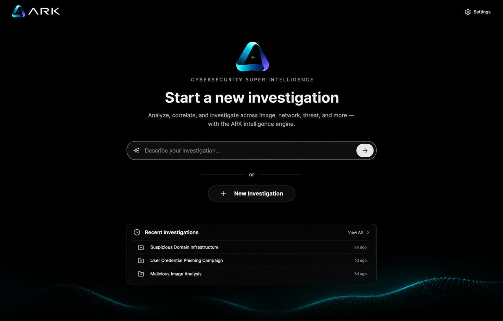

# ARK — Cybersecurity Super Intelligence

**An AI-native security investigation workstation by Arkspan Systems.**

Deterministic forensics, cryptographic evidence integrity, and governed agentic
reasoning in a single operational control plane.

[Overview](#overview) · [Screenshots](#screenshots) · [Capabilities](#capabilities) · [Architecture](#architecture) · [Downloads](#downloads) · [BYOK](#bring-your-own-keys)

---

> **Release status — in development.** No public installer has been published yet.
> This repository is ARK's **distribution and support channel**, not its development
> source repository. ARK is an active project; capabilities are added as development
> progresses. Expect frequent updates.

---

## Overview

ARK unifies deterministic forensic analysis, evidence management, security operations,
agentic reasoning, and controlled tool execution into one workstation. It is built around a
single principle:

> **The human operator decides what to investigate. ARK determines what can be trusted,
> what can be safely executed, and how the investigation is recorded with cryptographic
> integrity.**

Originating as an image-forensics and visual-intelligence platform, ARK has grown into a
multi-domain security control plane while keeping its deterministic forensic foundations.
It integrates a customized fork of the
[CAI (Cybersecurity AI) Robotics Framework](https://github.com/0x4rn0s/CAI) as its agent
substrate.

**Delivered as:** a FastAPI backend, a React workbench, an Electron desktop app, and an
optional React Native mobile companion.

---

## Screenshots

> Images are from an in-development build and are shown for demonstration only.

| Start an Investigation | Workspaces and Cases |
|---|---|
|  |  |

| Authorized Security Testing | Phishing & AiTM Assessment |
|---|---|
|  |  |

---

## Capabilities

### Investigation domains

| Domain | Focus | Status |
|---|---|---|
| **Image Intelligence (IMINT)** | EXIF/XMP metadata, Error Level Analysis (ELA), OCR, visual clue extraction, geolocation fusion, C2PA provenance, consistency & contradiction analysis | Active |
| **Network Security** | RDAP / BGP / DNS / certificate-transparency discovery, packet-capture analysis, HTTP security-header auditing, subdomain enumeration | Active |
| **OSINT** | Open-source discovery, reverse visual search, domain and perceptual-hash matching | Active |
| **Threat & SecOps** | Log correlation, detection, alert triage, incident management | Planned |
| **Cases & Vault** | Immutable evidence storage, chain-of-custody logging, audit bundles, cross-domain case management | Active |

### Investigation workflows

- **Direct Evidence Mode (deterministic).** Upload an artifact and get a reproducible,
  auditable forensic report: SHA-256 hashing, metadata extraction, forensic analysis,
  OCR and geolocation, then a court-ready case file.
- **AI Investigation Mode (goal-driven).** Start with an objective rather than a file.
  ARK proposes a plan, the analyst approves or modifies it, and ARK executes it through
  the tool registry — adapting the plan as new evidence appears.
- **Terminal Agent.** A live streaming console for natural-language interaction with
  slash commands (`/agent`, `/ws`, `/tools`, `/help`) and human-in-the-loop approvals.

### Forensic pipeline

Every investigation flows through a deterministic core: metadata extraction, a vision
ensemble, six clue extractors, and a consensus engine — followed by consistency,
contradiction, and geolocation-fusion passes that produce unified observations and a
court-ready report.

---

## Architecture

ARK separates responsibilities across three entities to keep epistemic rigor and
operational safety:

| Entity | Role | Outputs |
|---|---|---|
| **Operator (human)** | Intent, judgment, authorization, final assessment | Objectives, approvals, case disposition |
| **ARK Core** | Deterministic analysis, evidence preservation, hashing, tool runtime | Verified facts, sensor readings, raw logs |
| **ARK — Cybersecurity Super Intelligence** | The user-facing AI: planning, tool orchestration, multi-step reasoning, cross-domain correlation (runs on CAI) | Investigation plans, hypotheses, execution graph |

**Facts and hypotheses are kept structurally separate.** ARK Core produces facts; the AI
produces hypotheses. A hypothesis cannot be promoted to a finding without corroboration
from a higher epistemic tier, and this is enforced in the evidence graph — so a
contradiction always resolves in favor of the higher tier.

Core components:

| Component | Purpose |
|---|---|
| **Tool Registry** | Every capability the AI can call is registered with schema, permissions, risk level, cost estimate, and audit requirements. |
| **Evidence Graph** | Tamper-evident, hash-validated nodes and edges (corroborate / contradict / derived-from). The spine of the system. |
| **Policy Guard** | Authorization surface between planner and execution: capability permissions, risk-based approval tiers, budgets, and availability gating. |
| **Model Gateway** | Provider-agnostic LLM access with local and cloud providers. |

---

## Technology

| Layer | Technology |
|---|---|
| Backend | Python 3.11+, FastAPI, Pillow, piexif, pydantic, cryptography |
| AI / LLM | Ollama (local), OpenAI, Anthropic, Gemini, HuggingFace |
| Frontend | React 18, TypeScript 5, Vite 5, Leaflet |
| Desktop | Electron 32 (macOS / Windows / Linux) |
| Mobile | React Native 0.74, Expo 51 |
| Forensics | ExifTool, OCR, C2PA / Content Credentials |
| Security | AES-256-GCM field encryption, JWT + bcrypt authentication, SHA-256 chain-of-custody |

---

## Downloads

When an approved release is available, download it from this repository's
**[Releases](../../releases)** page. Download only assets attached to an official published
release.

| Platform | Planned artifact | Status |
|---|---|---|
| Windows | Signed installer (format to be confirmed) | Not published |
| macOS | Signed and notarized installer (format to be confirmed) | Not published |
| Linux | Distribution package (format to be confirmed) | Not published |

Checksums and verification instructions will accompany published assets. Never treat a
development build as a verified release.

---

## Bring your own keys

ARK is designed to run with your own AI provider credentials (BYOK) and can operate with a
local model. Supported providers, operating systems, installation prerequisites and
credential-storage behavior are documented with each validated release.

---

## Roadmap

| Phase | Scope | Status |
|---|---|---|
| A | Tool registry and tamper-evident evidence graph | Done |
| B | Policy / permission guard and audit emission | Done |
| C | Orchestrator loop: planner and executor for one goal | Done |
| D | Investigation console: plan / agent / evidence views | Done |
| E | Adaptive re-planning, contradiction loops, cost budgets | Done |
| F | Cross-domain reuse: register network and SecOps tools | Done |
| G | Case engine unification and cross-domain evidence graph | Planned |
| H | Model routing, provider failover, cost optimization | Planned |
| I | Court-ready evidence bundles and export formats | Planned |
| J | Analyst productivity, batch operations, collaborative cases | Planned |

---

## Safety and responsible use

ARK is intended for authorized cybersecurity investigation, research and defensive
operations. Operate only on systems and accounts you own or are expressly permitted to
assess. Tool availability and third-party provider terms may vary.

---

## Reporting issues and vulnerabilities

For ordinary bugs and feature requests, use **[Issues](../../issues)**. Do **not** post
credentials, sensitive logs, private investigation data, exploit details, or security
vulnerabilities in public issues. See [SECURITY.md](SECURITY.md) for responsible reporting
guidance.

---

## Licensing

THE ARK is released under the **MIT License**. It integrates the
[CAI (Cybersecurity AI) Robotics Framework](https://github.com/0x4rn0s/CAI), which retains
its own dual licensing: MIT for its OpenAI-derived components, and a research-use license
for proprietary Alias Robotics components. CAI is **not** relicensed under the MIT license
of THE ARK; commercial use of research-use components requires a separate license from
[Alias Robotics](https://aliasrobotics.com).

This repository hosts release information and distribution materials. See
[CONTRIBUTING.md](CONTRIBUTING.md) for how to report problems.

---

## Adding screenshots

1. Capture a screenshot from a supported build.
2. **Redact** any API keys, tokens, personal information, private investigation data,
   customer data and internal URLs.
3. Save it into [`docs/images/`](docs/images) and reference it from the Screenshots section.
4. Keep images reasonably sized (about 1600px wide).

Screenshots must not contain secrets or sensitive data.

---

**ARK — Investigate. Correlate. Preserve.**

*A security investigation environment where AI can reason and act without becoming the
authority over the evidence.*

Developed by **Arkspan Systems**.

